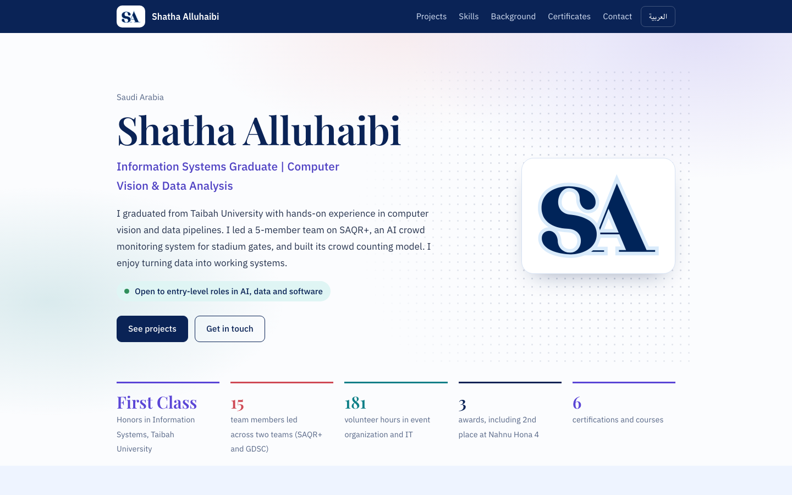

  

Information Systems graduate (**First Class Honors**), Taibah University.
I work on computer vision and data analysis, and I am looking for entry-level roles in AI, data and software.

## Projects

| Graduation project | Desktop app |
| --- | --- |
| [**SAQR+**](https://github.com/ShathaF/saqr-plus-showcase) AI-based crowd monitoring and decision support at stadium gates. Led a 5-member team. 2nd place at Nahnu Hona 4. | [**Secure Password Validator**](https://github.com/ShathaF/secure-password-validator) Java Swing app that enforces a password policy and stores salted SHA-256 hashes in SQLite. |

## Tools

بالعربي

**شذى اللهيبي**، خريجة نظم المعلومات بمرتبة الشرف الأولى، جامعة طيبة.
مهتمة بالرؤية الحاسوبية وتحليل البيانات، وأبحث عن فرص مبتدئة في الذكاء الاصطناعي والبيانات والبرمجيات.

[الموقع الشخصي](https://shatha-alluhaibi.vercel.app)

